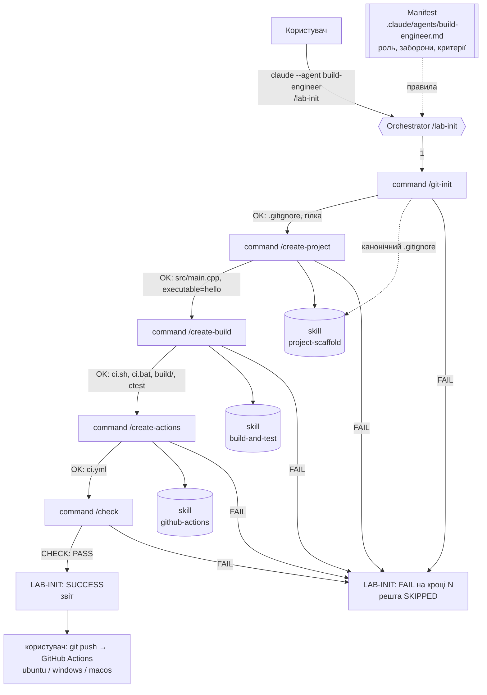

# Архітектура AI-агента `build-engineer`

## 1. Яку задачу вирішує агент

Ручне створення навіть найпростішого C++ проєкту з тестами і CI складається з
багатьох дрібних кроків, у яких легко помилитися: забути `enable_testing()`,
не зафіксувати версію GoogleTest, отримати конфлікт CRT на Windows, закомітити
`build/`, написати логіку збірки прямо у workflow, пропустити одну з ОС у
matrix. Агент `build-engineer` вирішує ці проблеми:

| Проблема | Як вирішує агент |
|----------|------------------|
| Неоднозначний запит «зроби проєкт» | точна специфікація кожного файлу у skills |
| Розбіжність локальної збірки і CI | вся логіка збірки — у `ci.sh`/`ci.bat`, `ci.yml` лише викликає їх |
| Невідтворювані залежності | GoogleTest через FetchContent із зафіксованим тегом `v1.15.2` |
| Артефакти/секрети в Git | `/git-init` формує `.gitignore`, `/check` перевіряє `git ls-files` |
| «Успіх» без перевірки | оркестратор завершується успіхом лише після `CHECK: PASS` |
| Повторний запуск ламає/дублює файли | кожна команда ідемпотентна: звіряє, а не перезаписує |
| Небезпечні дії AI | заборони у manifest + `allowed-tools` у командах + дозволи CLI |

## 2. Компоненти

### Manifest

`.claude/agents/build-engineer.md` — subagent Claude Code. Frontmatter
(`name`, `description`, `tools`, `skills`) задає назву, призначення, доступні
інструменти й попередньо завантажені skills; тіло — роль, область
відповідальності, правила роботи з файлами, заборонені дії, workflow, перелік
skills/commands, критерії завершення та формат звіту.

### Skills

| Skill | Призначення | Вхід | Вихід |
|-------|-------------|------|-------|
| `project-scaffold` | структура проєкту, Hello World, `.gitignore`, README | `language`, `project_name`, `executable`, `greeting` | `src/main.cpp`, `.gitignore`, `.gitattributes`, блок README |
| `build-and-test` | CMake, функція `add()`, GoogleTest, скрипти збірки | `project_name`, `cxx_standard`, `gtest_tag`, `build_dir`, `dist_dir` | `CMakeLists.txt`, `src/math.*`, `tests/test_math.cpp`, `ci.sh`, `ci.bat` |
| `github-actions` | CI workflow з matrix 3 ОС | `branches`, `os_matrix`, скрипти, `artifact_dir` | `.github/workflows/ci.yml` |

Кожен skill містить: коли застосовувати, вхідні дані, результат (точний вміст
файлів), порядок дій, перевірку, приклад входу, очікуваний результат, типовий
сценарій помилки та її обробку.

### Commands (доступні користувачу)

| Command | Дія | Skill | Змінює файли |
|---------|-----|-------|--------------|
| `/git-init` | перевіряє репозиторій, створює/доповнює `.gitignore`, показує стан Git | — (канонічний список з `project-scaffold`) | `.gitignore` |
| `/create-project` | створює початковий проєкт | `project-scaffold` | `src/main.cpp`, `.gitattributes`, `README.md` |
| `/create-build` | система складання, тест, скрипти + локальне складання | `build-and-test` | `CMakeLists.txt`, `src/math.*`, `tests/*`, `ci.sh`, `ci.bat` |
| `/create-actions` | CI workflow | `github-actions` | `.github/workflows/ci.yml` |
| `/check` | 9 груп перевірок, **нічого не змінює** | — | ні (лише ігнорований `build/`) |
| `/lab-init` | оркестратор: 1→5 зі зупинкою на помилці | усі | через кроки |

## 3. Взаємодія компонентів

| Елемент | Ким викликається | Що використовує | Що повертає |
|---------|------------------|-----------------|-------------|
| Manifest `build-engineer` | `claude --agent build-engineer` або першим кроком кожної команди («дій як агент…») | — | правила, заборони, критерії завершення для всієї сесії |
| `/lab-init` | користувач | manifest, 5 commands | таблиця кроків, `LAB-INIT: SUCCESS/FAIL` |
| `/git-init` | `/lab-init` крок 1 або користувач | канонічний `.gitignore` зі skill `project-scaffold` | `git-init: OK/FAIL`, гілка, стан Git |
| `/create-project` | `/lab-init` крок 2 | skill `project-scaffold` | файли проєкту, `executable=hello` |
| `/create-build` | `/lab-init` крок 3 | skill `build-and-test` | файли збірки, результат ctest |
| `/create-actions` | `/lab-init` крок 4 | skill `github-actions` | `ci.yml`, результати перевірок YAML |
| `/check` | `/lab-init` крок 5 або користувач | specs з manifest/skills/commands | таблиця 9 перевірок, `CHECK: PASS/FAIL` |

## 4. Дані, що передаються між етапами

| Від → до | Дані |
|----------|------|
| користувач → `/lab-init` | `$ARGUMENTS` (`project_name=…`), робочий каталог |
| `/git-init` → `/create-project` | корінь репозиторію, поточна гілка, підтвердження, що `build/`, `dist/` ігноруються |
| `/create-project` → `/create-build` | `src/main.cpp`, `project_name`, `executable=hello`, наявність компілятора |
| `/create-build` → `/create-actions` | шляхи `ci.sh` / `ci.bat`, каталог артефактів `dist/`, результат локального ctest |
| `/create-actions` → `/check` | `.github/workflows/ci.yml` |
| `/check` → `/lab-init` | таблиця PASS/FAIL по 9 групах + `CHECK: PASS/FAIL` |
| кожен крок → Git | окремий локальний коміт (лише якщо були зміни) |

Дані передаються через файлову систему (створені файли) і через текстові звіти
кроків у контексті сесії (`<команда>: OK|FAIL`, списки файлів, вивід перевірок).

## 5. Обробка помилок в оркестраторі

1. **Передумови** (`git`, `cmake`, `c++`, `.claude/commands`) перевіряються до
   будь-яких змін; якщо чогось бракує — `LAB-INIT: FAIL (передумови)`.
2. Після кожного кроку виконуються його «Команди перевірки». Кроком `FAIL`
   вважається як явна помилка команди, так і непройдена перевірка.
3. На першому `FAIL` оркестратор **зупиняється**: подальші кроки — `SKIPPED`,
   нічого не відкочується і не видаляється (видалення заборонене manifest-ом).
4. Звіт містить крок, причину, доказ (рядки виводу), список виконаних і
   пропущених кроків, конкретну дію для виправлення.
5. `LAB-INIT: SUCCESS` можливий лише після `CHECK: PASS` — оркестратор не
   вважає роботу успішною без перевірок.
6. Повторний запуск після виправлення продовжує з того самого місця
   природно: кроки, що вже виконані, нічого не змінюють (ідемпотентність).

## 6. Відповідність структурі з методички (Copilot → Claude Code)

Методичка описує формат GitHub Copilot (`.github/agents`, `.github/prompts`,
`.github/skills`). У роботі використано **Claude Code**, тому файли
розміщено у стандартних для нього каталогах; функції файлів збережено.

| Методичка (Copilot) | Claude Code (цей репозиторій) | Роль |
|---------------------|-------------------------------|------|
| `.github/agents/build-engineer.agent.md` | `.claude/agents/build-engineer.md` | manifest агента (subagent з frontmatter `name`, `description`, `tools`, `skills`) |
| `.github/skills/project-scaffold/SKILL.md` | `.claude/skills/project-scaffold/SKILL.md` | skill створення проєкту |
| `.github/skills/build-and-test/SKILL.md` | `.claude/skills/build-and-test/SKILL.md` | skill складання і тестування |
| `.github/skills/github-actions/SKILL.md` | `.claude/skills/github-actions/SKILL.md` | skill GitHub Actions |
| `.github/prompts/git-init.prompt.md` | `.claude/commands/git-init.md` → `/git-init` | command |
| `.github/prompts/create-project.prompt.md` | `.claude/commands/create-project.md` → `/create-project` | command |
| `.github/prompts/create-build.prompt.md` | `.claude/commands/create-build.md` → `/create-build` | command |
| `.github/prompts/create-actions.prompt.md` | `.claude/commands/create-actions.md` → `/create-actions` | command |
| `.github/prompts/check.prompt.md` | `.claude/commands/check.md` → `/check` | command перевірки |
| `.github/prompts/init.prompt.md` | `.claude/commands/lab-init.md` → `/lab-init` | orchestrator |
| `.github/workflows/ci.yml` | `.github/workflows/ci.yml` | CI (без змін — це формат GitHub, не AI-клієнта) |
| `src/`, `tests/`, `docs/`, `CMakeLists.txt`, `README.md`, `.gitignore` | ті самі шляхи | проєкт |

Особливості адаптації:

- **`/init` → `/lab-init`.** У Claude Code `/init` — вбудована команда, яка
  генерує `CLAUDE.md`. Щоб не перекривати її, оркестратор названо `lab-init`.
- **Commands = prompt files.** Файл `.claude/commands/<name>.md` стає
  slash-командою `/<name>`; frontmatter `description`, `argument-hint`,
  `allowed-tools` (дозволені інструменти під час виконання команди),
  `$ARGUMENTS` — аргументи.
- **Виклик команд з оркестратора.** Claude Code надає команди й skills моделі
  через інструмент `Skill`, тому `/lab-init` викликає кроки через нього; як
  запасний варіант — читає `.claude/commands/<name>.md` і виконує розділ «Дії».
- **Manifest як агент сесії.** `claude --agent build-engineer` робить manifest
  системними інструкціями всієї сесії (аналог вибору custom agent у Copilot
  Chat). Без цього прапорця кожна команда першим рядком посилається на manifest.
- **Обмеження безпеки** реалізовано на трьох рівнях: заборони в manifest,
  `allowed-tools` у кожній команді (наприклад, `/check` не має `Write`/`Edit`),
  і дозволи CLI (`--permission-mode`, `--allowedTools`) при запуску.

## 7. Обмеження агента

- Підтримується лише варіант 1 (C++17 / CMake / GoogleTest).
- Потрібна мережа для FetchContent під час конфігурації.
- Агент не виконує `git push` і не перевіряє GitHub Actions сам — це робить
  користувач (`git push`, `gh run watch`).
- Перевірка YAML локально — синтаксична (Ruby Psych / PyYAML), а не повна
  валідація схеми GitHub Actions.
